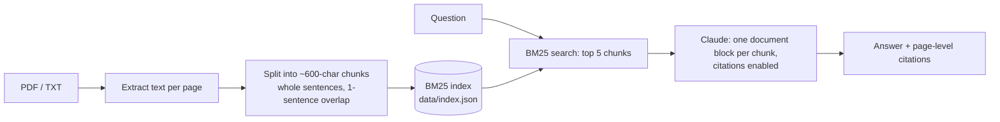

# DocuChat

**Ask questions about your PDFs and get answers that cite the exact page and sentence they came from.**

DocuChat is a small retrieval-augmented generation (RAG) app: it splits documents into
passages, finds the passages relevant to a question with a BM25 search engine written from
scratch, and has Claude answer *only* from those passages. Every claim in the answer comes back
with a machine-readable citation to its source page.


<!-- Add a screenshot or GIF of the app answering a question here: docs/screenshot.png -->

## Why it's built this way

| Decision | Reason |
|---|---|
| **Citations from the API, not from the prompt** | Each passage is sent as its own `document` block with citations enabled. Claude returns structured citations (document index + quoted sentence) that the app maps back to file and page. The model can't invent a page number, because the page comes from our own data. |
| **BM25 search written from scratch** | No vector database or embedding model is needed to run it, and it's fast and explainable: you can see *why* a passage scored high. The evaluation below shows where it falls short. |
| **Retrieve top 5, not top 1** | On the evaluation set the correct page is ranked *first* 83% of the time but is in the *top 5* 100% of the time. Sending 5 passages lets the model recover from imperfect ranking. |
| **Works without an API key** | Without a key the app and CLI show the best-matching passages instead of crashing, so anyone can try the search. |
| **Measured, not guessed** | `eval/run_eval.py` scores retrieval on 30 questions with known answer pages. Config changes are compared on numbers. |

## How it works



## Quick start

```bash
git clone https://github.com/oliverkraus-source/docuchat.git
cd docuchat
python -m venv .venv && source .venv/bin/activate
pip install -e ".[dev]"

export ANTHROPIC_API_KEY=sk-ant-...        # optional: without it you get search results only

python -m docuchat ingest sample_docs/brightwave_handbook.pdf
python -m docuchat ask "How many vacation days do I get?"

uvicorn docuchat.api:app --reload          # web UI at http://localhost:8000
```

Or with Docker:

```bash
docker build -t docuchat .
docker run -p 8000:8000 -e ANTHROPIC_API_KEY docuchat
```

## API

| Method | Path | Description |
|---|---|---|
| `GET` | `/` | Web UI |
| `GET` | `/api/health` | Status and number of indexed chunks |
| `GET` | `/api/documents` | Indexed documents |
| `POST` | `/api/documents` | Upload a `.pdf`, `.txt` or `.md` file (max 20 MB). Re-uploading replaces the old version. |
| `POST` | `/api/ask` | `{"question": "...", "k": 5}` → answer, citations and retrieved passages |

## Evaluation

The sample document `sample_docs/brightwave_handbook.pdf` is a **fictional** 8-page employee
handbook generated by `scripts/make_sample_pdf.py`. `eval/questions.json` holds 30 questions,
each labelled with the page that answers it:

- **keyword** questions (18) use words from the text ("How many vacation days…")
- **paraphrase** questions (12) avoid them ("How much time off do I get each year?")

```bash
python eval/run_eval.py
```

| Config | hit@1 | hit@3 | hit@5 | MRR |
|---|---|---|---|---|
| chunks 600, stemming (default) | 83% | 100% | 100% | 0.91 |
| chunks 600, no stemming | 87% | 100% | 100% | 0.93 |
| chunks 300, stemming | 80% | 93% | 100% | 0.88 |
| chunks 1200, stemming | 87% | 100% | 100% | 0.93 |

| Question type (default config) | n | hit@1 | hit@5 |
|---|---|---|---|
| keyword | 18 | 94% | 100% |
| paraphrase | 12 | 67% | 100% |

*hit@k = share of questions whose answer page is in the top k results. MRR = mean reciprocal rank.*

**What this shows**

- Keyword search is strong when the question shares words with the text, and clearly weaker on
  paraphrases: "Can I **fly**…" vs. "**flights**", "new **computer**" vs. "**laptop**".
- Small chunks (300 chars) hurt: facts get split from their context.
- Stemming vs. no stemming differs by one question out of 30, which is noise at this sample size.
  I kept stemming because it matches word forms like *reimbursed / reimburse*, which the unit tests check.
- This is a small, single-document benchmark. It's useful for comparing configurations, not as a
  claim about performance on arbitrary documents.

## Limitations and next steps

- **Hybrid search.** Add embedding-based semantic search and merge it with BM25 (e.g. reciprocal
  rank fusion) to fix the paraphrase gap. The eval above is the yardstick for whether it helps.
- **Answer-level evaluation.** The eval scores retrieval. The next step is grading generated
  answers for correctness and checking that every citation actually supports its claim.
- **Scanned PDFs** have no text layer and would need OCR.
- **Storage** is a JSON file, which is fine for hundreds of documents. A real deployment would use
  a database and per-user document collections.

## Project structure

```
docuchat/
  ingest.py     PDF/TXT -> pages -> sentence-aware chunks with page numbers
  search.py     BM25 index (from scratch), tokenizer, save/load
  answer.py     Claude request with citable document blocks, citation parsing
  api.py        FastAPI app: upload, ask, web UI
  __main__.py   CLI: ingest / ask
  static/       single-page web UI
eval/           questions with known answer pages + evaluation script
scripts/        generates the fictional sample PDF
tests/          unit tests, API tests, SDK request/response test (no network needed)
```

## Tests

```bash
pytest          # 19 tests, no API key or network needed
ruff check .
```

CI runs lint, tests and the retrieval evaluation on every push.
